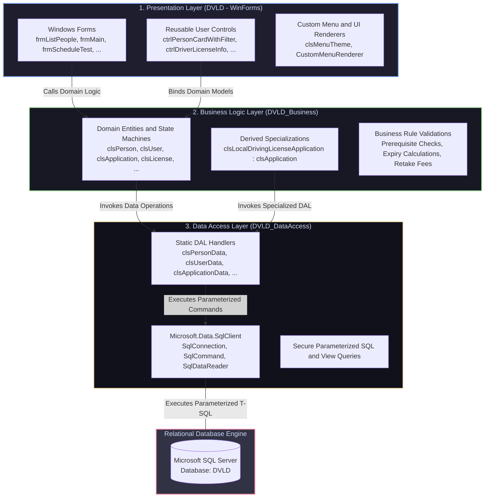
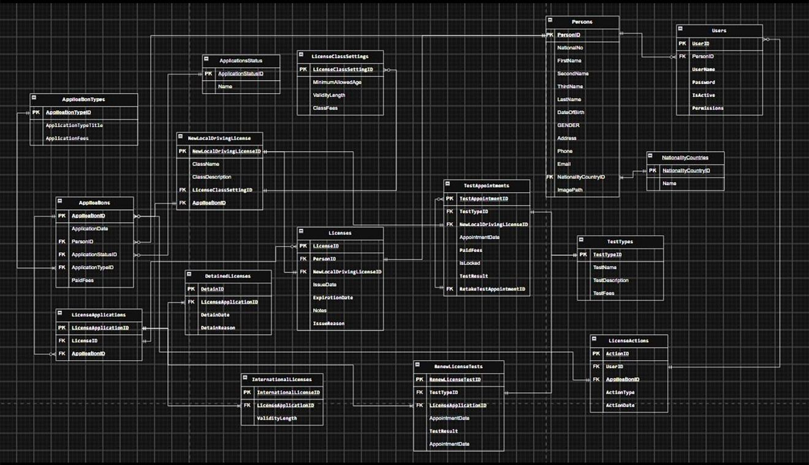
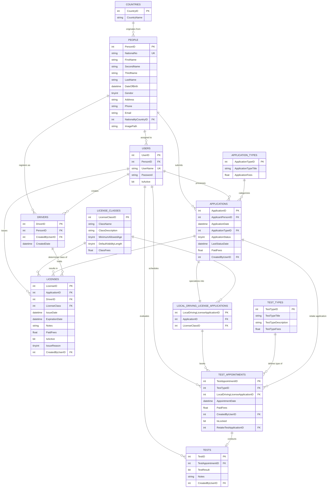
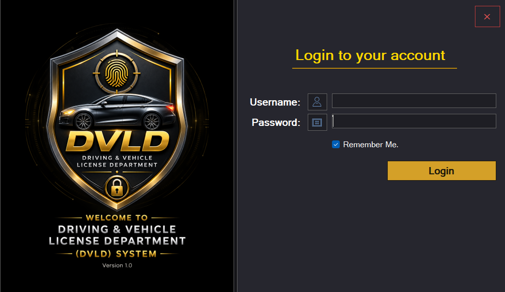
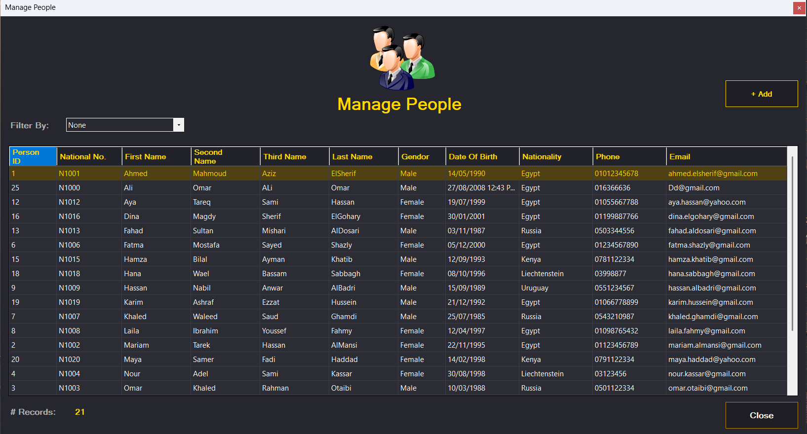
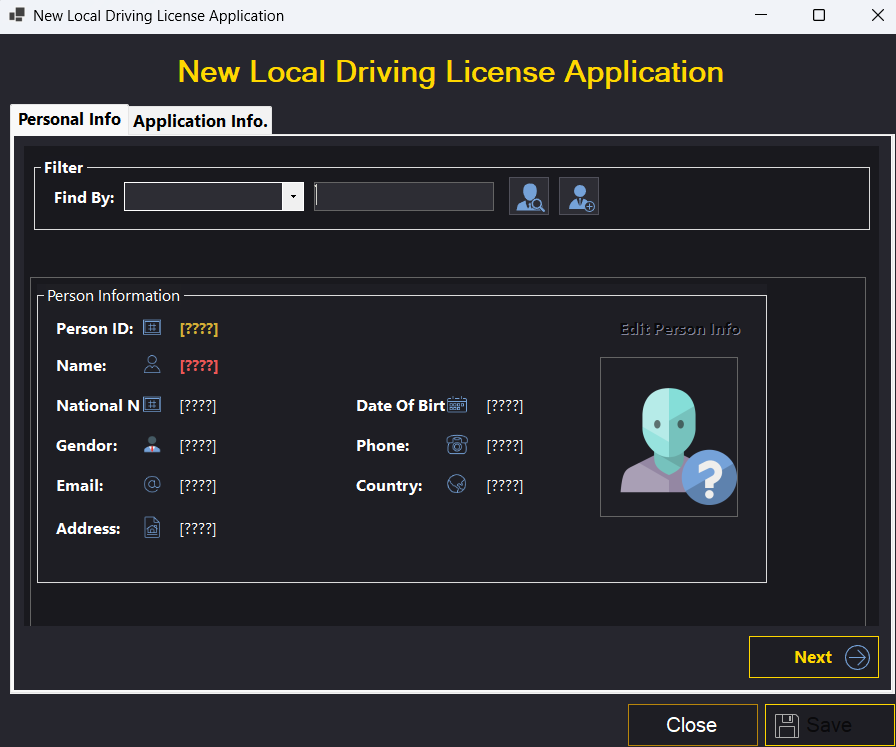

# 🏛️ DVLD – Driving & Vehicle License Department

<div align="center">

[](https://learn.microsoft.com/en-us/dotnet/csharp/)
[](https://dotnet.microsoft.com/)
[](https://learn.microsoft.com/en-us/dotnet/desktop/winforms/)
[](https://www.microsoft.com/en-us/sql-server/)
[](https://learn.microsoft.com/en-us/dotnet/framework/data/adonet/)
[](https://www.nuget.org/packages/Microsoft.Data.SqlClient)
[](#-05-architecture--layer-responsibilities)

**An enterprise-grade, multi-tier desktop management system built in C# (.NET 10) and Windows Forms for driving license administration, applicant testing workflows, and license lifecycle governance.**

[Overview](#-02-project-overview) • [Key Features](#-03-key-features) • [System Modules](#-04-system-modules) • [Architecture](#-05-architecture--layer-responsibilities) • [Database Design](#-06-database-design--entity-relationships) • [Engineering Highlights](#-07-technical-highlights--engineering-decisions) • [Screenshots](#-12-screenshots) • [Author](#-13-author--contact)

</div>

---

## 📖 02. Project Overview

The **Driving & Vehicle License Department (DVLD)** system is a mission-critical desktop enterprise application engineered to automate, govern, and streamline the complete operational lifecycle of driver licensing. Traditional licensing departments frequently struggle with manual record keeping, fragmented testing workflows, human error in fee assessments, and the risk of fraudulent test passing or license issuance.

### 🎯 Primary Objectives
- **Process Automation:** Automate the multi-step journey of driving license applicants—from initial person registration and application submission, through sequential examination scheduling, to final license issuance.
- **Strict Business Rule Enforcement:** Enforce prerequisite test sequences (Vision Test $\rightarrow$ Written Test $\rightarrow$ Practical/Street Test) programmatically, ensuring no exam or appointment can be scheduled out of order.
- **Data Integrity & Traceability:** Maintain an immutable audit trail by tracking which authenticated officer or system user created every application, scheduled appointments, evaluated tests, and issued licenses.
- **Componentized, Scalable Design:** Apply a strict **3-Tier Architecture** that decouples presentation, business domain logic, and data access routines to maximize maintainability, testability, and code reusability.

---

## ✨ 03. Key Features

### 👤 People & Demographics Registry
- **Centralized Citizen Registry:** Central person records decoupled from system users, applicants, or drivers.
- **National ID Uniqueness:** Enforces strict uniqueness of National Identity numbers across the database.
- **GUID-Sanitized Image Storage:** Manages personal portraits using GUID file renames and centralized directory isolation to avoid path collisions or file overwrites.
- **Advanced Dynamic Filtering:** Search and filter records in real-time by Person ID, National No, First Name, Second Name, Last Name, Nationality, Gender, Phone, or Email.

### 🔐 User Management & Security
- **Role-Ready System Users:** Link system accounts to individual person profiles with unique usernames and activation toggles (`IsActive`).
- **Authentication & Inactive Account Guarding:** Authenticates credentials at login and immediately blocks deactivated accounts from accessing the system.
- **Session State & Persistence:** Maintains application-wide active user state (`clsGlobal.CurrentUser`) and provides secure local credential caching ("Remember Me" option).
- **In-App Account Controls:** Authenticated users can view their profile card and update their password with verification against their existing password.

### 📋 Application Management (Local Driving Licenses)
- **Unified Base Application Model:** Handles core application attributes (Applicant Person, Application Date, Application Type, Application Status, Last Status Date, Paid Fees, Created By User) via OOP inheritance.
- **Class-Based Licensing Applications:** Supports multiple license categories (e.g., Small Motorcycle, Heavy Motorcycle, Ordinary Driving License, Commercial, Heavy Transport) with distinct minimum ages, validity periods, and statutory fees.
- **Application Lifecycle Transitions:** Automatically transitions status through `New`, `Cancelled`, and `Completed` based on testing progression and issuance milestones.

### 🧪 Sequential Test Management & Appointments
- **Prerequisite Examination Pipeline:** Applicants must strictly pass all 3 formal examinations in chronological order:
  1. **Vision Test**
  2. **Written Test** (Blocked until Vision is passed)
  3. **Street / Practical Test** (Blocked until Written is passed)
- **Appointment Scheduling & Locking:** Allows scheduling appointments with validation against active prior bookings. Upon recording an exam result, the appointment is automatically **locked** (`IsLocked = true`) to prevent tampering.
- **Automated Retake Test Workflow:** If an applicant fails an exam, the system detects prior attendance (`DoesAttendTestType`), creates a linked **Retake Test Application**, and calculates the combined test and retake fees.

### 🪪 Driver & License Issuance
- **Automated Driver Creation:** When all 3 tests are successfully completed, issuing a license automatically checks for an existing Driver record for that person or instantiates a new one seamlessly.
- **Dynamic Validity Calculation:** Computes expiration dates dynamically using the configured validity period of the specific license class (`DateTime.Now.AddYears(DefaultValidityLength)`).
- **Status Locking:** Successfully issuing the license updates the underlying application status to `Completed` and activates the license record.

### ⚙️ Master Data Configuration
- **Application Types Catalog:** View and edit system-wide fees and titles for application categories (New Driving License, Renew, Replacement for Lost/Damaged, Retake Test).
- **Test Types Catalog:** View and update test types, their descriptions, and associated exam fees.

---

## 🧩 04. System Modules

The application is structured into specialized, domain-focused modules:

| Module | Primary Responsibilities | Key Forms & Controls |
| :--- | :--- | :--- |
| **People Management** | Manage central demographics, contact details, national ID validation, and profile pictures. | `frmListPeople`, `frmAddUpdatePerson`, `frmFindPerson`, `frmShowPersonInfo`, `ctrlPersonCard`, `ctrlPersonCardWithFilter` |
| **User & Access Control** | Authentication, account activation, system user administration, password updates, and user session context. | `frmLogin`, `frmListUsers`, `frmAddUpdateUser`, `frmUserInfo`, `frmChangePassword`, `ctrlUserCard` |
| **Applications (LDL)** | Create, list, filter, edit, cancel, and inspect Local Driving License Applications. | `frmListLocalDrivingLicenseApplications`, `frmAddUpdateLocalDrivingLicesnseApplication`, `frmLocalDrivingLicenseApplicationInfo`, `ctrlApplicationBasicsInfo`, `ctrlDrivingLicenseApplicationInfo` |
| **Examinations & Testing** | Appointment scheduling, prerequisite checks, retake test generation, exam result entry, and appointment locking. | `frmListTestAppointments`, `frmScheduleTest`, `frmTakeTest`, `frmListTestTypes`, `frmEditTestType`, `ctrlScheduleTest`, `ctrlSecheduledTest` |
| **Drivers & Licenses** | Driver registry, first-time license issuance, license card inspection, and validity tracking. | `frmIssueDriverLicenseFirstTime`, `frmShowLicenseInfo`, `ctrlDriverLicenseInfo`, `ctrlDriverLicenseInfoWithFilter` |
| **Application Types Configuration** | Maintain official statutory fees and titles for all application categories. | `frmListApplicationTypes`, `frmEditApplicationTypes` |

---

## 🏗️ 05. Architecture & Layer Responsibilities

DVLD strictly implements the classic **3-Tier Architecture**, enforcing unidirectional dependencies and strict Separation of Concerns (SoC).



### 1. Presentation Layer (`DVLD`)
- **Technology:** Windows Forms targeting `.NET 10.0-windows`.
- **Role:** Pure UI and user interaction. Captures user input, handles UI validations, displays data grids, and raises events.
- **Crucial Rule:** Zero direct database access or SQL commands. All actions flow through domain classes in `DVLD_Business`.
- **Componentization:** Heavy use of reusable custom composite controls (`ctrlPersonCardWithFilter`, `ctrlScheduleTest`) utilizing C# events (`event Action<int> OnPersonSelected`) for loose coupling.

### 2. Business Logic Layer (`DVLD_Business`)
- **Technology:** Class Library targeting `.NET 10.0`.
- **Role:** Implements domain models, state management, inheritance hierarchies, and operational rules.
- **Patterns Used:**
  - **State Machine Mode:** Uses `enMode { AddNew = 0, Update = 1 }` to automatically route `.Save()` invocations to internal `_AddNew()` or `_Update()` routines.
  - **Inheritance & Polymorphism:** `clsLocalDrivingLicenseApplication` derives from `clsApplication`, reusing base application behaviors while cascading `.Save()` and `.Delete()` operations.
  - **Static Factory / Finder Methods:** Public static methods (`Find(id)`, `FindByUsernameAndPassword(...)`) instantiate populated entity objects using private constructors.

### 3. Data Access Layer (`DVLD_DataAccess`)
- **Technology:** Class Library targeting `.NET 10.0` with `Microsoft.Data.SqlClient` (v7.0.2).
- **Role:** Low-level persistence operations. Establishes connections, executes parameterized SQL queries, reads records via `SqlDataReader`, and safely maps columns to C# primitive types with `DBNull` validation.
- **Security:** 100% parameterized queries; no dynamic SQL string concatenation.

<details>
<summary><b>🔍 Code Walkthrough: Unidirectional Data Flow in Action</b></summary>

#### Step 1: Presentation Layer triggers business workflow
```csharp
// In frmIssueDriverLicenseFirstTime.cs
private void btnIssueLicense_Click(object sender, EventArgs e)
{
    int LicenseID = _LocalDrivingLicenseApplication.IssueLicenseForTheFirstTime(
        txtNotes.Text.Trim(), 
        clsGlobal.CurrentUser.UserID
    );

    if (LicenseID != -1)
    {
        MessageBox.Show($"License Issued Successfully with License ID = {LicenseID}", 
                        "Succeeded", MessageBoxButtons.OK, MessageBoxIcon.Information);
        this.Close();
    }
}
```

#### Step 2: Business Layer evaluates prerequisites & orchestrates sub-entities
```csharp
// In clsLocalDrivingLicenseApplication.cs
public int IssueLicenseForTheFirstTime(string Notes, int CreatedByUserID)
{
    // 1. Resolve or create Driver record
    clsDriver Driver = clsDriver.FindByPersonID(this.ApplicantPersonID);
    if (Driver == null)
    {
        Driver = new clsDriver { PersonID = this.ApplicantPersonID, CreatedByUserID = CreatedByUserID };
        if (!Driver.Save()) return -1;
    }

    // 2. Instantiate and populate new License
    clsLicense License = new clsLicense();
    License.ApplicationID = this.ApplicationID;
    License.DriverID = Driver.DriverID;
    License.LicenseClass = this.LicenseClassID;
    License.IssueDate = DateTime.Now;
    License.ExpirationDate = DateTime.Now.AddYears(this.LicenseClassInfo.DefaultValidityLength);
    License.Notes = Notes;
    License.PaidFees = this.LicenseClassInfo.ClassFees;
    License.IsActive = true;
    License.IssueReason = clsLicense.enIssueReason.FirstTime;
    License.CreatedByUserID = CreatedByUserID;

    // 3. Save license and complete application
    if (License.Save())
    {
        this.SetComplete(); // Sets status to Completed and updates LastStatusDate
        return License.LicenseID;
    }
    return -1;
}
```

#### Step 3: Data Access Layer executes secure SQL
```csharp
// In clsLicenseData.cs
public static int AddNewLicense(int ApplicationID, int DriverID, int LicenseClass,
    DateTime IssueDate, DateTime ExpirationDate, string Notes, float PaidFees,
    bool IsActive, byte IssueReason, int CreatedByUserID)
{
    int LicenseID = -1;
    using (SqlConnection connection = new SqlConnection(clsDataAccessSettings.ConnectionString))
    {
        string query = @"INSERT INTO Licenses (ApplicationID, DriverID, LicenseClass, IssueDate,
                                               ExpirationDate, Notes, PaidFees, IsActive,
                                               IssueReason, CreatedByUserID)
                         VALUES (@ApplicationID, @DriverID, @LicenseClass, @IssueDate,
                                 @ExpirationDate, @Notes, @PaidFees, @IsActive,
                                 @IssueReason, @CreatedByUserID);
                         SELECT SCOPE_IDENTITY();";

        using (SqlCommand command = new SqlCommand(query, connection))
        {
            command.Parameters.AddWithValue("@ApplicationID", ApplicationID);
            command.Parameters.AddWithValue("@DriverID", DriverID);
            command.Parameters.AddWithValue("@LicenseClass", LicenseClass);
            command.Parameters.AddWithValue("@IssueDate", IssueDate);
            command.Parameters.AddWithValue("@ExpirationDate", ExpirationDate);
            command.Parameters.AddWithValue("@Notes", string.IsNullOrEmpty(Notes) ? (object)DBNull.Value : Notes);
            command.Parameters.AddWithValue("@PaidFees", PaidFees);
            command.Parameters.AddWithValue("@IsActive", IsActive);
            command.Parameters.AddWithValue("@IssueReason", IssueReason);
            command.Parameters.AddWithValue("@CreatedByUserID", CreatedByUserID);

            connection.Open();
            object result = command.ExecuteScalar();
            if (result != null && int.TryParse(result.ToString(), out int insertedID))
                LicenseID = insertedID;
        }
    }
    return LicenseID;
}
```
</details>

---

## 🗄️ 06. Database Design & Entity Relationships

The underlying relational schema is normalized to **Third Normal Form (3NF)** with referential integrity enforced via foreign key constraints and primary keys.

### 📊 Database Relational Schema Diagram
<div align="center">
  
  <p><em>Figure: SQL Server Relational Database Architecture & Foreign Key Constraints</em></p>
</div>

<br/>

### 📐 Entity-Relationship Diagram (ERD)



### Database Tables Catalog

| Table | Description | Primary Key | Key Foreign Keys |
| :--- | :--- | :--- | :--- |
| `Countries` | Reference table of world countries. | `CountryID` | None |
| `People` | Central demographic data for all individuals. | `PersonID` | `NationalityCountryID` $\rightarrow$ `Countries.CountryID` |
| `Users` | System operator and administrator accounts. | `UserID` | `PersonID` $\rightarrow$ `People.PersonID` |
| `ApplicationTypes` | Catalog of application categories and their standard fees. | `ApplicationTypeID` | None |
| `Applications` | Master applications table recording transactions, fees, and statuses. | `ApplicationID` | `ApplicantPersonID` $\rightarrow$ `People`, `ApplicationTypeID` $\rightarrow$ `ApplicationTypes`, `CreatedByUserID` $\rightarrow$ `Users` |
| `LicenseClasses` | Driving categories (Car, Motorcycle, Truck, etc.) and constraints. | `LicenseClassID` | None |
| `LocalDrivingLicenseApplications` | Sub-table specializing general applications for local driving categories. | `LocalDrivingLicenseApplicationID` | `ApplicationID` $\rightarrow$ `Applications`, `LicenseClassID` $\rightarrow$ `LicenseClasses` |
| `TestTypes` | Catalog of test stages: 1: Vision, 2: Written, 3: Street. | `TestTypeID` | None |
| `TestAppointments` | Booking slots for examination attempts. | `TestAppointmentID` | `TestTypeID` $\rightarrow$ `TestTypes`, `LocalDrivingLicenseApplicationID` $\rightarrow$ `LocalDrivingLicenseApplications`, `CreatedByUserID` $\rightarrow$ `Users`, `RetakeTestApplicationID` $\rightarrow$ `Applications` |
| `Tests` | Physical exam results recorded by examiners. | `TestID` | `TestAppointmentID` $\rightarrow$ `TestAppointments`, `CreatedByUserID` $\rightarrow$ `Users` |
| `Drivers` | Individuals who hold or qualify for driving credentials. | `DriverID` | `PersonID` $\rightarrow$ `People`, `CreatedByUserID` $\rightarrow$ `Users` |
| `Licenses` | Issued driving credentials with validity and expiration bounds. | `LicenseID` | `ApplicationID` $\rightarrow$ `Applications`, `DriverID` $\rightarrow$ `Drivers`, `LicenseClass` $\rightarrow$ `LicenseClasses`, `CreatedByUserID` $\rightarrow$ `Users` |

### Database Views
The database utilizes denormalized SQL views to optimize read performance for DataGridView controls:
- **`ApplicationsList_View`:** Flattens application records with applicant full name and application type title.
- **`LocalDrivingLicenseApplications_View`:** Consolidates local license applications, applicant names, national IDs, driving class title, and count of passed tests.
- **`Drivers_View`:** Joins driver entities with person demographics and active licenses count.
- **`TestAppointments_View`:** Provides appointment listings with formatted date, test fees, and lock status.

---

## ⚙️ 07. Technical Highlights & Engineering Decisions

### 1. Object-Oriented Domain Modeling & Inheritance
Rather than using generic untyped datasets across the system, DVLD models real-world domain concepts as rich C# classes. For example, `clsLocalDrivingLicenseApplication` derives directly from `clsApplication`:
- Automatically reuses base attributes (`ApplicantPersonID`, `ApplicationDate`, `PaidFees`, `CreatedByUserID`).
- Implements layered persistence where `base.Save()` is executed first to populate the parent `Applications` table, followed by inserting the specialization record into `LocalDrivingLicenseApplications`.
- Cascades deletions: when an application is removed, the specialized child record is deleted prior to deleting the base record, maintaining referential integrity.

### 2. State Machine Pattern (`enMode`)
All primary business entities implement an `enMode` enumeration (`AddNew = 0`, `Update = 1`).
- Instantiating an empty entity defaults to `AddNew`.
- Loading an existing entity via static factory methods (`Find(ID)`) triggers a private constructor that sets the mode to `Update`.
- Calling `.Save()` delegates internally to private `_AddNew()` or `_Update()` routines, providing a clean, expressive API to the presentation layer without leaking SQL syntax.

### 3. Loose Coupling via Custom Events & Composite Controls
User interface elements are built as modular User Controls (`ctrlPersonCardWithFilter`, `ctrlScheduleTest`).
- `ctrlPersonCardWithFilter` encapsulates person search and card display. When an individual is located or selected, it raises a strongly-typed C# event:
  ```csharp
  public event Action<int> OnPersonSelected;
  ```
- Parent forms subscribe to this event cleanly without depending on child control internals or form hierarchies.

### 4. Parameterized Query Security & Null-Safe Mapping
- **SQL Injection Prevention:** Every database command uses parameterized `SqlCommand.Parameters.AddWithValue` or explicit parameter binding. Dynamic SQL concatenation is strictly forbidden.
- **Nullable Column Defense:** Nullable database columns (`ThirdName`, `Email`, `ImagePath`, `Notes`, `RetakeTestApplicationID`) are checked with `reader[col] != DBNull.Value` before casting, preventing runtime `InvalidCastException` errors.

### 5. Robust File System Management for Media
- User portraits uploaded via `ctrlPersonCard` are not stored as database BLOBs (which bloats SQL databases).
- Instead, images are renamed using cryptographically unique GUID strings (`clsUtil.ReplaceFileNameWithGUID`), sanitized, and copied into a structured local directory (`C:\DVLD\DVLD-People-Images\`), storing only the relative/absolute file path string in the database.

---

## 📁 08. Project Structure

```text
DVLD_Project/
│
├── DVLD/                                       # Presentation Layer (WinForms, .NET 10)
│   ├── Application/                            # Application-related forms & controls
│   │   ├── ApplicationTypes/                   # Manage Application Types & Fees
│   │   │   ├── frmEditApplicationTypes.cs
│   │   │   └── frmListApplicationTypes.cs
│   │   ├── Controls/                           # Reusable Application User Controls
│   │   │   ├── ctrlApplicationBasicsInfo.cs
│   │   │   └── ctrlPersonCardWithFilter.cs
│   │   └── LocalDrivingLicenseApplications/    # Local Driving License application screens
│   │       ├── ctrlDrivingLicenseApplicationInfo.cs
│   │       ├── frmAddUpdateLocalDrivingLicesnseApplication.cs
│   │       ├── frmListLocalDrivingLicenseApplications.cs
│   │       └── frmLocalDrivingLicenseApplicationInfo.cs
│   │
│   ├── GlobalClasses/                          # System-wide utilities, session & formatting
│   │   ├── clsFormat.cs                        # Date & currency formatters
│   │   ├── clsGlobal.cs                        # Active user session & credential persistence
│   │   ├── clsMenuTheme.cs                     # Dark theme ToolStrip & MenuStrip renderers
│   │   ├── clsUtil.cs                          # GUID generators & media file handlers
│   │   └── clsValidation.cs                    # Regular expression & data validation
│   │
│   ├── Licenses/                               # License issuance & inspection
│   │   └── Local Licenses/
│   │       ├── Controls/
│   │       │   ├── ctrlDriverLicenseInfo.cs
│   │       │   └── ctrlDriverLicenseInfoWithFilter.cs
│   │       ├── frmIssueDriverLicenseFirstTime.cs
│   │       └── frmShowLicenseInfo.cs
│   │
│   ├── Login/                                  # Authentication screens
│   │   └── frmLogin.cs
│   │
│   ├── Main/                                   # Application dashboard & navigation
│   │   └── frmMain.cs
│   │
│   ├── People/                                 # Demographics & citizen directory
│   │   ├── Controls/
│   │   │   ├── ctrlPersonCard.cs
│   │   │   └── ctrlPersonCardWithFilter.cs
│   │   ├── frmAddUpdatePerson.cs
│   │   ├── frmFindPerson.cs
│   │   ├── frmListPeople.cs
│   │   └── frmShowPersonInfo.cs
│   │
│   ├── Tests/                                  # Examination scheduling & test taking
│   │   ├── Controls/
│   │   │   ├── ctrlScheduleTest.cs
│   │   │   └── ctrlSecheduledTest.cs
│   │   ├── TestTypes/
│   │   │   ├── frmEditTestType.cs
│   │   │   └── frmListTestTypes.cs
│   │   ├── frmListTestAppointments.cs
│   │   ├── frmScheduleTest.cs
│   │   └── frmTakeTest.cs
│   │
│   ├── User/                                   # User account administration
│   │   ├── ctrlUserCard.cs
│   │   ├── frmAddUpdateUser.cs
│   │   ├── frmChangePassword.cs
│   │   ├── frmListUsers.cs
│   │   └── frmUserInfo.cs
│   │
│   ├── Program.cs                              # Application entry point
│   ├── DVLD.csproj                             # WinForms project configuration (.NET 10)
│   └── DVLD.slnx                               # Solution file
│
├── DVLD_Business/                              # Business Logic Layer (Class Library, .NET 10)
│   ├── clsApplication.cs                       # Base application domain entity
│   ├── clsApplicationType.cs                   # Application types & fee management
│   ├── clsCountry.cs                           # Country reference domain entity
│   ├── clsDriver.cs                            # Driver entity & license association
│   ├── clsLicense.cs                           # Driving license entity & validity rules
│   ├── clsLicenseClass.cs                      # License class constraints & categories
│   ├── clsLocalDrivingLicenseApplication.cs    # Derived local license logic & test pipeline
│   ├── clsPerson.cs                            # Person domain model & profile routines
│   ├── clsTest.cs                              # Test execution & result recording
│   ├── clsTestAppointment.cs                   # Appointment scheduling & locking rules
│   ├── clsTestType.cs                          # Examination type configuration
│   ├── clsUser.cs                              # User entity & authentication methods
│   └── DVLD_Business.csproj                    # BLL project file
│
├── DVLD_DataAccess/                            # Data Access Layer (ADO.NET, .NET 10)
│   ├── clsApplicationData.cs                   # SQL operations for Applications table
│   ├── clsApplicationTypeData.cs               # SQL operations for ApplicationTypes table
│   ├── clsCountryData.cs                       # SQL operations for Countries table
│   ├── clsDataAccessSettings.cs               # Connection string configuration
│   ├── clsDriverData.cs                        # SQL operations for Drivers table
│   ├── clsLicenseClassData.cs                  # SQL operations for LicenseClasses table
│   ├── clsLicenseData.cs                       # SQL operations for Licenses table
│   ├── clsLocalDrivingLicenseApplicationData.cs # SQL operations for LDL Applications table
│   ├── clsPersonData.cs                        # SQL operations for People table
│   ├── clsTestAppointmentData.cs               # SQL operations for TestAppointments table
│   ├── clsTestData.cs                          # SQL operations for Tests table
│   ├── clsTestTypeData.cs                      # SQL operations for TestTypes table
│   ├── clsUserData.cs                          # SQL operations for Users table
│   └── DVLD_DataAccess.csproj                  # DAL project file (Microsoft.Data.SqlClient)
│
└── Screenshots/                                # Application screenshots & schema diagrams
    ├── Database_Schema.jpeg
    ├── 01_Login_Screen.png
    ├── 02_Main_Dashboard.png
    ├── 03_Manage_People.png
    └── 04_New_Local_Driving_License_Application.png
```

---

## 🛠️ 09. Technology Stack

| Layer / Category | Technology | Version | Purpose |
| :--- | :--- | :--- | :--- |
| **Language** | C# | 13.0 / Latest | Primary programming language |
| **Runtime Framework** | .NET | 10.0 | Target framework for BLL, DAL, and UI |
| **UI Framework** | Windows Forms | 10.0 Desktop | Native desktop graphical user interface |
| **Database Engine** | Microsoft SQL Server | 2019 / 2022 | Relational database management system |
| **Data Provider** | `Microsoft.Data.SqlClient` | 7.0.2 | Official high-performance ADO.NET SQL client |
| **Architecture** | 3-Tier Architecture | Classic SoC | Unidirectional separation of UI, BLL, and DAL |
| **Development IDE** | Microsoft Visual Studio | 2022 / Later | Solution authoring, building, and debugging |

---

## 🚀 10. Getting Started

Follow these instructions to set up the local development environment and run the DVLD system.

### Prerequisites
- **Operating System:** Windows 10 / Windows 11 (64-bit).
- **.NET SDK:** [.NET 10.0 SDK](https://dotnet.microsoft.com/) installed.
- **IDE:** [Visual Studio 2022](https://visualstudio.microsoft.com/) (version 17.12+ recommended) with the **.NET desktop development** workload selected.
- **Database Engine:** [Microsoft SQL Server](https://www.microsoft.com/en-us/sql-server/sql-server-downloads) (Express, Developer, or Enterprise edition) and [SQL Server Management Studio (SSMS)](https://learn.microsoft.com/en-us/sql/ssms/download-sql-server-management-studio-ssms).

### Installation & Execution Steps

#### 1. Clone the Repository
```bash
git clone https://github.com/mostafamansour745-dotcom/DVLD_3TierArc.git
cd DVLD_3TierArc
```

#### 2. Configure the Database
1. Launch SQL Server Management Studio (SSMS) and connect to your SQL Server instance.
2. Create a new database named `DVLD`:
   ```sql
   CREATE DATABASE DVLD;
   GO
   ```
3. Execute the database creation scripts (tables, foreign keys, constraints, and views: `ApplicationsList_View`, `LocalDrivingLicenseApplications_View`, `Drivers_View`, `TestAppointments_View`).

#### 3. Update the Connection String
Open `DVLD_DataAccess\clsDataAccessSettings.cs` and configure your local SQL Server instance details:
```csharp
namespace DVLD_DataAccess
{
    public static class clsDataAccessSettings
    {
        // Update Server name, Credentials, or use Windows Authentication
        public static string ConnectionString = 
            "Server=YOUR_SERVER_NAME;Database=DVLD;Integrated Security=True;TrustServerCertificate=True;";
    }
}
```

#### 4. Prepare Image Storage Directory
The system saves profile portraits to `C:\DVLD\DVLD-People-Images\`. Ensure the parent folder exists or create it:
```powershell
New-Item -ItemType Directory -Path "C:\DVLD\DVLD-People-Images\" -Force
```

#### 5. Build and Run the Solution
You can build and launch the project via Visual Studio or via the .NET CLI:
```bash
# Restore dependencies and build the entire solution
dotnet build

# Launch the Windows Forms Presentation project
dotnet run --project DVLD/DVLD.csproj
```

---

## 🔐 11. Configuration & Security Best Practices

### Connection String Security
- In `DVLD_DataAccess\clsDataAccessSettings.cs`, the default configuration specifies connection parameters.
- For local development, **Windows Integrated Authentication** (`Integrated Security=True;` or `Trusted_Connection=True;`) is strongly recommended over hardcoded SQL Server `sa` credentials.
- **Notice:** Never commit production database passwords or sensitive environment connection strings to public version control repositories.

### Media Storage
- Citizen photos are isolated outside the project build directory in `C:\DVLD\DVLD-People-Images\`. This prevents accidental loss of uploaded pictures during project clean, rebuild, or Git reset operations.

---

## 🖼️ 12. Screenshots

<div align="center">

| 01. Authentication & Security | 02. Main Dashboard & Navigation |
| :---: | :---: |
|  <br/> **Login Screen with "Remember Me" Credential Caching** |  <br/> **Custom Themed Main Dashboard & Navigation Menu** |
| **03. Citizen Demographics Registry** | **04. Driving License Application Wizard** |
|  <br/> **Manage People Directory with Multi-Column Filtering** |  <br/> **New Local Driving License Application with Person Card Filter** |

</div>

---

## 👨‍💻 13. Author & Contact

**Mostafa Mansour**  
*Software Engineer & .NET Developer*

- 🌐 **GitHub:** [@mostafamansour745-dotcom](https://github.com/mostafamansour745-dotcom)
- 💼 **LinkedIn:** [Mostafa Mansour](https://www.linkedin.com/in/mostafa-mansour-1ab050381)
- 📧 **Email:** [mostafamansour745@gmail.com](mailto:mostafamansour745@gmail.com)
- 📂 **Project Repository:** [DVLD_3TierArc](https://github.com/mostafamansour745-dotcom/DVLD_3TierArc)

---

<div align="center">
<sub>Engineered with precision using C#, .NET 10, Windows Forms, and Microsoft SQL Server.</sub>
</div>
